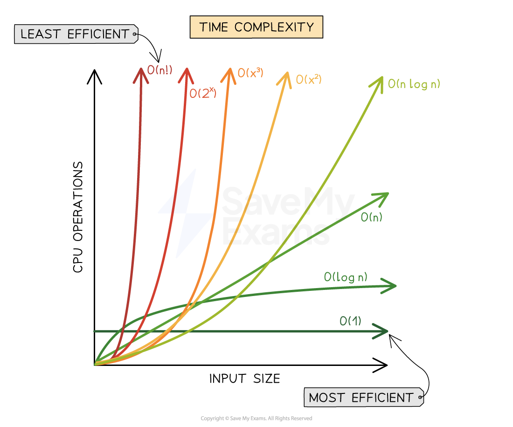

# Связанные списки и сложность алгоритмов

## Сложность алгоритмов (Big O)

**Big O** — нотация для оценки наихудшего случая временной сложности алгоритма. Показывает, как изменится производительность при росте входных данных.

### Классы сложности

| Класс | Название | Пример |
|-------|----------|--------|
| **O(1)** | Константная | Доступ к элементу массива по индексу |
| **O(log n)** | Логарифмическая | Бинарный поиск |
| **O(n)** | Линейная | Линейный поиск, один цикл |
| **O(n log n)** | Линейно-логарифмическая | Цикл + бинарный поиск внутри |
| **O(n²)** | Квадратичная | Вложенные циклы, пузырьковая сортировка |
| **O(n³)** | Кубическая | Три вложенных цикла |
| **O(2ⁿ)** | Экспоненциальная | Рекурсивный расчёт чисел Фибоначчи |
| **O(n!)** | Факториальная | Полный перебор всех перестановок |

## Связанные списки

**Связанный список** — структура данных, хранящая элементы в линейном порядке. Каждый узел содержит данные и указатель на следующий элемент. Последний узел указывает на `NULL`.

### Виды связанных списков

| Тип | Описание |
|-----|----------|
| **Односвязный** | Каждый узел указывает только на следующий |
| **Двусвязный** | Узел указывает на следующий и предыдущий |
| **Циклический (кольцевой)** | Последний узел указывает на первый |

---

