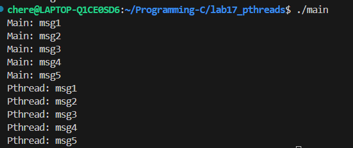
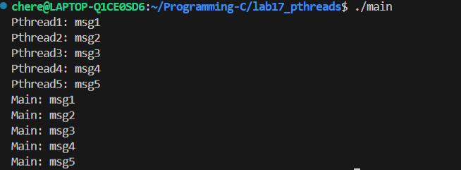
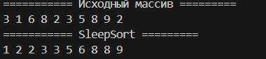

# Отчет по практическому заданию №6: Threads

## 1. Создание и ожидание потока (Упр. 1-2)
Была написана программа, создающая поток через `pthread_create`. 
- В первом варианте потоки работали параллельно.
- Во втором варианте добавлена функция `pthread_join(tid, NULL)`, которая блокирует выполнение `main`, пока дочерний поток не завершит вывод своих 5 строк.

**Ключевые функции:** `pthread_create`, `pthread_join`.

---

## `Упражнение 1` — Базовое создание потоков
``` c
#include <stdio.h>
#include <pthread.h>
#define N 5

void *thread(void *argP) {
    for (int i = 1; i <= N; i++) {
        printf("Pthread: msg%d\n", i);
    }
}

int main() {
    pthread_t tid;
    pthread_create(&tid, NULL, thread, NULL); 

    for (int i = 1; i <= N; i++) {
        printf("Main: msg%d\n", i);
    }
}
```



## `Упражнение 2` — Синхронизация через pthread_join
``` c
#include <stdio.h>
#include <pthread.h>
#define N 5

void *thread(void *argP) {
    for (int i = 1; i <= N; i++) {
        printf("Pthread: msg%d\n", i);
    }
}

int main() {
    pthread_t tid;
    pthread_create(&tid, NULL, thread, NULL); 
    pthread_join(tid, NULL);
    for (int i = 1; i <= N; i++) {
        printf("Main: msg%d\n", i);
    }
}
```


---

## 2. Параметры потока (Упр. 3)
Реализовано создание 4-х потоков. Каждый поток получает через аргументы (`void *argP`) уникальную строку.
- Для передачи данных использовался массив строк.
- Программа подтверждает возможность выполнения одной и той же функции с разными входными данными в параллельных потоках.

## `Упражнение 3` — Передача аргументов в потоки
``` c
#include <stdio.h>
#include <pthread.h>
#define N 5

typedef struct {
    int num;
    char *msg;
} threadData;

void *thread(void *argP) {
    threadData *d =  (threadData *)argP;
    printf("Pthread%d: %s\n", d->num, d->msg);
}

int main() {
    pthread_t tid[N];
    threadData data[N];
    char *messages[] = {"msg1", "msg2", "msg3", "msg4", "msg5"};
    for (int i = 0; i < N; i++) {
        data[i].num = i + 1;
        data[i].msg = messages[i];
        pthread_create(&tid[i], NULL, thread, &data[i]);
    } 

    for (int i = 0; i < N; i++) {
         pthread_join(tid[i], NULL);
    }
    
    for (int i = 1; i <= N; i++) {
        printf("Main: msg%d\n", i);
    }
}
```

---

## 3. Завершение и очистка (Упр. 4-5)
Реализован механизм принудительной остановки 5 потоков через `pthread_cancel`.
- Чтобы потоки корректно завершались, использованы макросы `pthread_cleanup_push` и `pthread_cleanup_pop`.
- В функции очистки (`cleanup handler`) реализован вывод сообщения о смерти потока. 
- Это гарантирует, что даже при экстренной остановке через `cancel`, поток успеет выполнить критически важные действия (в данном случае — уведомление).
## `Упражнения 4-5` — Безопасное прерывание потоков
``` c
#include <stdio.h>
#include <pthread.h>
#include <unistd.h>
#define N 5
#define C 10

typedef struct {
    int num;
    char *msg;
} threadData;

void *thread_SleepSort(void *arg) {
    int num = *(int *)arg;
    sleep(num);
    printf("%d ", num);
    fflush(stdout);
}

void SleepSort(int arr[], int c_arr) {
    pthread_t tid[c_arr];
    for (int i = 0; i < c_arr; i++) {
        pthread_create(&tid[i], NULL, thread_SleepSort, &arr[i]);
    }
    
    for (int i = 0; i < c_arr; i++) {
        pthread_join(tid[i], NULL);
    }
}

void killThread(void *arg) {
    int num = *(int *)arg;
    printf("Pthread%d dead\n", num);
}

void *thread(void *argP) {
    threadData *d =  (threadData *)argP;
    pthread_cleanup_push(killThread, &(d->num));
    printf("Pthread%d: %s\n", d->num, d->msg);
    sleep(3);
    printf("Pthread%d: Succes\n", d->num);
    pthread_cleanup_pop(0);
}

int main() {
    pthread_t tid[N];
    threadData data[N];
    char *messages[] = {"msg1", "msg2", "msg3", "msg4", "msg5"};
    for (int i = 0; i < N; i++) {
        data[i].num = i + 1;
        data[i].msg = messages[i];
        pthread_create(&tid[i], NULL, thread, &data[i]);
    } 
    

    for (int i = 0; i < N; i++) {
         pthread_cancel(tid[i]);
    }

    for (int i = 0; i < N; i++) {
         pthread_join(tid[i], NULL);
    }
    
    for (int i = 1; i <= N + 1; i++) {
        printf("Main: msg%d\n", i);
    }
}
```

---

## 4. Сортировка Sleepsort (Упр. 6)
Реализован алгоритм сортировки с временной сложностью $O(max(N))$.
- Для каждого числа `x` создается поток, выполняющий `sleep(x)`.
- Благодаря `fflush(stdout)` числа выводятся в терминал в порядке возрастания сразу после пробуждения потока.
## `Упражнение 6` — Реализация алгоритма SleepSort
``` c
#include <stdio.h>
#include <pthread.h>
#include <unistd.h>
#define N 5
#define C 10

typedef struct {
    int num;
    char *msg;
} threadData;

void *thread_SleepSort(void *arg) {
    int num = *(int *)arg;
    sleep(num);
    printf("%d ", num);
    fflush(stdout);
}

void SleepSort(int arr[], int c_arr) {
    pthread_t tid[c_arr];
    for (int i = 0; i < c_arr; i++) {
        pthread_create(&tid[i], NULL, thread_SleepSort, &arr[i]);
    }
    
    for (int i = 0; i < c_arr; i++) {
        pthread_join(tid[i], NULL);
    }
}

void killThread(void *arg) {
    int num = *(int *)arg;
    printf("Pthread%d dead\n", num);
}

void *thread(void *argP) {
    threadData *d =  (threadData *)argP;
    pthread_cleanup_push(killThread, &(d->num));
    printf("Pthread%d: %s\n", d->num, d->msg);
    sleep(3);
    printf("Pthread%d: Succes\n", d->num);
    pthread_cleanup_pop(0);
}

int main() {
    pthread_t tid[N];
    threadData data[N];
    char *messages[] = {"msg1", "msg2", "msg3", "msg4", "msg5"};
    for (int i = 0; i < N; i++) {
        data[i].num = i + 1;
        data[i].msg = messages[i];
        pthread_create(&tid[i], NULL, thread, &data[i]);
    } 
    

    for (int i = 0; i < N; i++) {
         pthread_cancel(tid[i]);
    }

    for (int i = 0; i < N; i++) {
         pthread_join(tid[i], NULL);
    }
    
    for (int i = 1; i <= N; i++) {
        printf("Main: msg%d\n", i);
    }

    int arr[] = {3, 1, 6, 8, 2, 3, 5, 8, 9, 2};
    printf("=========== Исходный массив =========\n");
    for (int i = 0; i < sizeof(arr) / sizeof(int); i++) {
        printf("%d ", arr[i]);
    }
    printf("\n=========== SleepSort =========\n");
    SleepSort(arr, 10);
    printf("\n");
}
```



---


